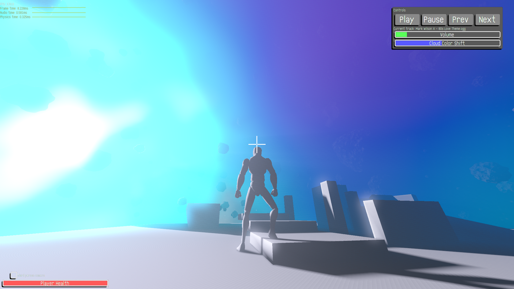

# vkEngine


vkEngine, my long term "game engine" project.<br>
Might end up as an actual game at some point, no idea when.<br>

This started long long ago in 2004, with OpenGL and ATI GPU demos... My only game that has actually used this "engine" was my [Tetris game/graphics demo](https://github.com/seishuku/Tetris).<br>

I have an old [OpenGL version](https://github.com/seishuku/Engine) as wel, but I haven't done anything with it since switching to Vulkan, it's just around for historical reasons and is archived now.<br>

I love doing everything my self with as little external library dependencies as possible.<br>
This is an on-going learning experience for me and for anyone else that can learn from my code, I try to keep it clean and readable.<br>
> "Building square wheels to better appreciate the round ones."

---

## To-do (in no particular order):
- Improve audio (needs pops/clicks fixed on Windows)
- Improve physics (needs more refining, it doesn't pass a box stack very well)
- Streamline post processing effects (WIP)
- Improve networking (this is better now, [server here](https://github.com/seishuku/vkEngineServer))
- ???
- Profit?

---

External dependencies for building this (versions as of this writing, newer *should* work):
 - `libvorbis` 1.3.7
 - `libogg` 1.3.5
 - `OpenXR` 1.2
 - `Vulkan` 1.3.231.1

> Note: recursive clone to fetch submodules

---

## Controls:
- `W/A/S/D` Typical strafe movement
- `Q/E` Roll
- `Up/Down arrows` Pitch
- `Left/Right arrows` Yaw
- `Space` Fire projectile
- `Control` Fire "laser"
- `` ~/` `` Opens console
- `Z` "Explode" asteroid field (used for testing physics)
- `O` Generate new random play area
- `P` Pauses all physics except for camera

> Mouse interacts with UI, but also controls ship pitch/yaw.

---

## Building:
Should be pretty straightforward cmake:<br>
```cmake -S. -B out -GNinja```<br>
or use a preset:<br>
```cmake -S. --preset "linux_x64_release"```<br>
```cmake -S. --preset "windows_x64_release"```<br>
```cmake -S. --preset "android_arm64_release"```<br>
```cmake -S. --preset "linux_aarch64_release_cross"```<br><br>
Then ```cmake --build 'path to build directory'```<br>
> <b>Note:</b> Android building requires the SDK with NDK properly set up with ANDROID_HOME set correctly. This also currently targets a specific NDK version, edit presets file to the version you have installed.<br>
> As do the cross compile preset targets, they need a properly set up sysroot or cross build environment.

---

## Network:
To connect to a server, just bring up the console in game with '~'/'`' and type:<br>
```connect XXX.XXX.XXX.XXX```<br>
Where XXX.XXX.XXX.XXX is the remote IP.
> <b>Note:</b> Networking is very much a WIP.

## Engine Features

**Graphics and Rendering**
- Vulkan-based rendering backend
- Configurable rendering pipelines with embeddable SPIR-V binary shader code
- Lighting and shadow-rendering systems
- Skybox rendering
- Bloom and post-processing infrastructure
- Custom 3D model format with skeletal animation

**Physics and Simulation**
- Custom rigid-body physics system
- Sphere, capsule and oriented-box collision detection
- Constraint and solver infrastructure with web browser based assembly tool
- Attractor forces
- Particle system
- 6 DOF physics based camera with 1st person and chase views
- Character controller with 1st person and chase views
- IK skeleton pose manipulation (useful for character foot placement, hand touching, weapon holding, etc)

**Audio**
- Custom audio subsystem with HRTF based positional sound
- Digital signal processing
- Sound-effect generator
- WAV audio file support
- QOA audio file support
- Ogg Vorbis integration for music

**Virtual Reality and Networking**
- OpenXR integration with dedicated VR subsystem
- Client networking infrastructure (WIP)

**UI and Input**
- Custom UI framework
- Windows, buttons and checkboxes
- Text rendering and text editing
- Sprites (with animation), cursors and graph widgets
- Virtual joystick component
- Keyboard and mouse input
- In-game console

**Engine Core and Utilities**
- Asset management
- Entity management
- QOI and TGA image support
- Vector, matrix and quaternion mathematics
- Frustum and spatial-query utilities
- Bounding-volume hierarchy and spatial hashing
- Memory-zone and threading utilities
- Event, configuration and parsing utilities
- Loading screen support
- Browser/web based physics assembly tool (LLM generated)
- Browser/web based UI editing tool (LLM generated)
- Blender BModel/BAnim import/export addon (LLM generated)

**Build targets**
- Windows x64
- Linux x64/aarch64
- Android ARM64
